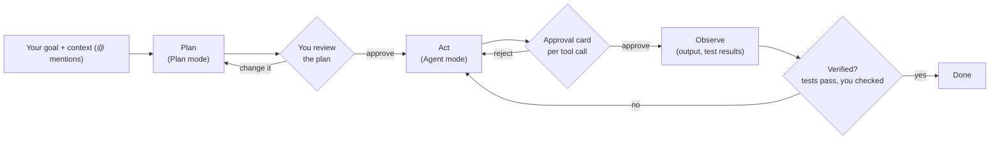

# IBM Bob · Agentic AI in Action: end-to-end guide

For **participants** (university students, any department) and **facilitators**. Read top to bottom once; then use it as a reference during the session.

| Part | For | Time |
|---|---|---|
| [1. What you'll learn](#1-what-youll-learn) | everyone | 1 min |
| [2. Before the day](#2-before-the-day) | everyone | 15 min, at home |
| [3. Agentic AI in 5 minutes](#3-agentic-ai-in-5-minutes) | everyone | 5 min |
| [4. Meet CampusRoute](#4-meet-campusroute) | everyone | 3 min |
| [5. Pick your scenarios](#5-pick-your-scenarios) | everyone | 2 min |
| [6. How to work through a card](#6-how-to-work-through-a-card) | everyone | 2 min |
| [7. The seven scenarios at a glance](#7-the-seven-scenarios-at-a-glance) | everyone | reference |
| [8. Show and tell](#8-show-and-tell) | everyone | 4 min |
| [9. Rules: safety, privacy, integrity](#9-rules-safety-privacy-integrity) | everyone | 2 min |
| [10. After the workshop](#10-after-the-workshop) | everyone | reference |
| [11. Troubleshooting](#11-troubleshooting) | everyone | reference |
| [12. Facilitator section](#12-facilitator-section) | facilitators | 10 min |

---

## 1. What you'll learn

By the end you will have used an AI agent to **plan, act, and verify** on a real codebase, and you will have caught it being wrong at least once.

Concretely, you'll be able to:
- choose the right **mode** (Ask, Plan, Agent) for a task;
- give the agent precise **context** with `@` mentions (files, line ranges, URLs, `.docx`);
- review **plans** and **approval cards** before anything changes on your machine;
- make the agent **prove** its work with tests, not with confident prose;
- extend the agent with **skills**, **custom modes** and **rules**.

---

## 2. Before the day

### Participants
1. **Get Bob access.** Your organizer sends instructions for installing **IBM Bob** and signing in. Open it once and make sure the chat panel answers `hello`.
2. **Install Python 3.9 or newer.** Check with `python3 --version` (Windows: `py --version`).
3. *(Optional, Scenario 4)* **Node.js 18+**: `node --version`.
4. **Get the repository** somewhere without spaces in the path: `git clone https://github.com/barissozen95/bobathon.git bobathon` (or download the ZIP from GitHub and rename the folder to `bobathon`).
5. **Open the `bobathon/` folder in Bob as the workspace** (File → Open Folder). This matters: all `@/...` paths in the cards start from this folder.
6. **Run the check:**
   ```bash
   cd bobathon
   bash setup-check.sh
   ```
   Green = ready. Yellow = some scenarios unavailable (it tells you which). Red = ask the facilitator.

### Facilitators
See [section 12](#12-facilitator-section). The `facilitator/` folder (run-of-show, rehearsal checklist, package builder) is in the facilitator copy only, not in the public repository. Rehearse in a **real Bob session** before the day.

---

## 3. Agentic AI in 5 minutes

A chatbot answers. An **agent** pursues a goal: it reads files, makes a plan, uses tools (write a file, run a command), looks at the result and tries again. That's powerful and risky, so Bob keeps **you** in the loop.



### The three modes (mode selector under the chat box)
| Mode | Can read files | Can write files | Can run commands | Use it to… |
|---|---|---|---|---|
| **Ask** | ✅ | ❌ | ❌ | understand, analyse, get hints. *Safe to experiment.* |
| **Plan** | ✅ | Markdown/text only | ❌ | design before building; produces a plan file |
| **Agent** | ✅ | ✅ (with approval) | ✅ (with approval) | build, change, run tests |

> **When unsure, start in Ask.** It can't change anything.

### Context: `@` mentions
| You type | Bob gets |
|---|---|
| `@/app/campusroute/routing.py` | the whole file (path from workspace root) |
| `@/app/campusroute/legacy/kiosk_router.py:219-232` | only those lines |
| `@/scenarios/s7-career-and-interview/cv.docx` | the text of a Word file |
| `@https://en.wikipedia.org/wiki/A*_search_algorithm` | a web page |
| select code + `Cmd/Ctrl + L` | the selection, added to the chat |

### Approval cards
Before Agent mode writes a file or runs a command, Bob shows a card. **Read it:** which file? which command? Approve once, approve for the task, or reject and say why. Keep auto-approve **off** in this workshop.

### Teaching Bob new tricks
| Feature | Where | Used in |
|---|---|---|
| **Skill**: reusable instructions Bob loads when the description matches | `.bob/skills/<name>/SKILL.md` | Scenario 2 |
| **Custom mode**: a role + allowed tool groups (e.g. read-only) | `.bob/custom_modes.yaml` | Scenarios 2, 7 |
| **Rule**: always-on guidance | `.bob/rules/*.md` | Scenario 2 bonus |
| **AGENTS.md**: project context and commands | workspace root | everywhere |

### The habit that matters most
**Bob can be fluent, confident and wrong.** In every scenario you will check at least one claim against the file, the numbers or the tests. The cards mark these with **Check:**.

---

## 4. Meet CampusRoute

All seven scenarios use one app, so what you learn in one carries over.

```bash
cd app
python3 -m campusroute route "Main Gate" "ENG-B204"
python3 -m campusroute route "SCI-110" "ENG-B204" --avoid-stairs
python3 -m campusroute search kutuphane
python3 -m campusroute serve            # open http://127.0.0.1:8000
python3 -m unittest discover -s tests   # 63 tests, all green
```

| Part | What it does | Scenario |
|---|---|---|
| `campusroute/routing.py` | Dijkstra shortest walking route, avoid stairs, via | 1, 3 |
| `campusroute/search.py` | Turkish-aware fuzzy search ("kutuphane" finds "kütüphane") | 3 |
| `campusroute/schedule.py` | Class schedule CSV, conflicts, "next class" | **4** |
| `campusroute/legacy/kiosk_router.py` | 339 lines of inherited, uncommented code | **5** |
| `campusroute/api.py` + `web/` | JSON API + map UI on 127.0.0.1 | 7 bonus |
| `docs/BACKLOG.md` | real work items (CR-9 … CR-20) | **6**, all |

Try one Ask-mode question right now to warm up:

```text
@/app/README.md @/app/docs/ARCHITECTURE.md In 5 bullets: what does CampusRoute do and how do the modules depend on each other?
```

---

## 5. Pick your scenarios

Pick **two** from the [menu](scenarios/README.md). Each takes ~10 minutes for the core steps.

| # | Scenario | Coding? | Overrun risk |
|---|---|---|---|
| 1 | Messy lecture → study page | No | Low |
| 2 | Teach Bob to grade (skill + read-only mode) | Read Python | Medium |
| 3 | Build a language: RouteQL | Yes | **High** |
| 4 | Port `schedule.py` to JavaScript (or Java/Swift…) | Yes | **High** |
| 5 | Understand legacy code | Read Python | Low |
| 6 | Plan a team sprint, then change it | No | Medium |
| 7 | CV review / interview take-home | Path B only | **High** |

**Not a programmer?** 1 + 6. **Early CS?** 5 + 1 or 5 + 2. **Confident coder?** 3 + 5 or 4 + 2. **Job hunting?** 7 + 6. Don't pair two "High" ones in a 30-minute session.

---

## 6. How to work through a card

Every `CARD.md` has the same shape:

| Section | What to do |
|---|---|
| Header | Track, coding needed, time, Bob features, link to the app/backlog |
| **Why this matters** | 20 seconds. The real-world reason |
| **You will produce** | Your finish line |
| **Inputs** / **Before you start** | Files you'll mention; prerequisites |
| **Core steps** | Copy the `text` prompt blocks into Bob. Do the **Check:** after each |
| **Bonus** | Only if time remains |
| **If you get stuck** | Ready-made recovery prompts |
| **Your responsibility** | What you, not Bob, must verify |

Tips:
- Start a **new chat** (**+**) for each scenario so contexts don't mix.
- Paste prompts as-is first; then experiment with your own wording.
- Your outputs go in the scenario's `out/` or `plans/` folder. Inputs stay untouched.
- If a step overruns, the card says which steps are the core. Stop there and you've still done it.

---

## 7. The seven scenarios at a glance

**1. Messy lecture → study page** · [card](scenarios/s1-lecture-to-study-page/CARD.md)
CS201 notes on BFS/Dijkstra/A*. Ask extracts concepts and draws a Mermaid map in chat; Agent writes a one-file HTML study page. One claim in the notes is **wrong**: can you and Bob find it?

**2. Teach Bob to grade** · [card](scenarios/s2-assignment-grader/CARD.md)
Grade three synthetic Lab 4 submissions with a rubric using a **skill**, then try to make the read-only **Assignment Grader mode** edit a file. It can't: permissions are configuration. Deep path: write the skill yourself.

**3. Build a language (RouteQL)** · [card](scenarios/s3-build-a-language/CARD.md)
`route "Main Gate" to "ENG-B204" avoid stairs`. Plan mode designs lexer, parser and interpreter; you critique the plan; a new Agent task implements it against the real routing engine; 16 acceptance tests decide.

**4. Port a real module** · [card](scenarios/s4-translate-code/CARD.md)
`schedule.py` → JavaScript with 20 tests. Find the traps first (Sunday=0, `%` on negatives, dict order, CSV quotes), then translate, port tests, and never change an expected value. Finish with literate coding.

**5. Understand legacy code** · [card](scenarios/s5-understand-legacy-code/CARD.md)
A terse 339-line router with an LRU cache. Line-range mentions, Explain with Bob, a call-flow diagram, then **write your own explanation** and let Bob correct you.

**6. Plan a team sprint** · [card](scenarios/s6-project-plan/CARD.md)
Brief + backlog + team availability → phases, owners, capacity table, gantt. Audit the arithmetic (the 1-hour meeting is *inside* the hours), then break the plan with "Mert is sick in week 3".

**7. CV and interview** · [card](scenarios/s7-career-and-interview/CARD.md)
Path A: review a synthetic `.docx` CV against a real-looking posting; improve it **without inventing experience**. Path B: case-study questions, then a 14-test take-home ("Open now?") with Bob as a coach, not a ghostwriter.

---

## 8. Show and tell

In the last minutes, 2-3 people share. Good things to show:
- **Something Bob got wrong that you caught**, and how. *This is the best possible demo.*
- S1's study page or S6's gantt chart on screen.
- S3/S4: the test run going green, and one approval card you **rejected**.
- S5: your 3-sentence note before and after Bob's correction.

---

## 9. Rules: safety, privacy, integrity

| Rule | Why |
|---|---|
| Keep **auto-approve off**; read every approval card | The agent can write files and run commands on *your* machine |
| Never approve `sudo`, `rm -rf`, `curl … \| sh`, `pip/npm install` in this workshop | Nothing here needs them |
| No `eval`/`exec`/`subprocess` in interpreters | Input must never become code |
| Servers on `127.0.0.1` only | Don't expose your laptop to the venue Wi-Fi |
| No secrets (API keys, passwords) in prompts or files | Prompts and files can be logged |
| All people here are **synthetic**. Strip phone, address, DOB and ID from your own CV before using it | Personal data protection |
| Don't paste classmates' work or real student data | Consent and law |
| Using Bob to write coursework you submit as your own is cheating | Follow your course's AI policy |
| **You** are responsible for what you ship | Bob is a tool; tests and review are your proof |

---

## 10. After the workshop

Keep going on your own laptop; the workspace is yours.

| Next step | How |
|---|---|
| Finish your second scenario's bonus | Each card has 1-2 bonus steps |
| Ship a backlog item end to end | Pick one from `app/docs/BACKLOG.md` (CR-11 "Open now?" and CR-15 dark theme are good first issues). Plan mode → new task → Agent → tests green → explain it |
| Run the **Bobathon challenge** (team format) | Ask your facilitator for the 2-hour format: teams ship one backlog item, judged on tests and process |
| Build your own skill | Something you repeat weekly: lab reports, flashcards, commit messages |
| Make a read-only "study buddy" mode | Like Scenario 2's grader, with `groups: [read]` |

---

## 11. Troubleshooting

| Symptom | Fix |
|---|---|
| Bob doesn't find `@/app/...` | You opened the wrong folder. The workspace root must be `bobathon/` |
| Agent mode doesn't write a file | Check the mode selector; Ask can't write. Check if an approval card is waiting |
| Too many approval cards | Normal. In Permissions you can allow **read**/**edit** for the current task. Never auto-allow **execute** |
| Mermaid error in chat | `Rewrite as a simple flowchart TD with every label in double quotes.` |
| `python3: command not found` | Windows: try `py`. Otherwise tell the facilitator |
| `ModuleNotFoundError: campusroute` | Run app commands from inside `app/` |
| Port 8000 busy | `python3 -m campusroute serve --port 8010` |
| Bob is slow | Shorter prompts, fewer `@` files, new chat. Steps marked core are enough |
| Bob invents line numbers or facts | That's why you check. Ask it to quote the exact line |
| You broke an input file | Restore it with `git checkout -- <file>`, or ask the facilitator |

---

## 12. Facilitator section

### Formats
| Format | Length | Structure |
|---|---|---|
| **Taster** | 30 min | 4 min demo · 2 min pick · 2 × 10 min scenarios · 4 min share |
| **Bobathon** | 2 h | 15 min demo + CampusRoute tour · 45 min two scenarios · 45 min team challenge on a backlog item · 15 min demos + judging |

Full minute-by-minute scripts, the demo, the judging rubric and fallbacks: `facilitator/RUN-OF-SHOW.md` (facilitator copy only).

### What's in the facilitator pack (never shipped to participants)
| Item | Location |
|---|---|
| Reference outputs and answer keys | `scenarios/*/reference/` |
| S3 reference interpreter (16/16 tests) | `scenarios/s3-build-a-language/reference/routeql.py` |
| S4 reference JS port (22/22 tests, mutation-checked) | `scenarios/s4-translate-code/reference/js/` |
| S7 take-home solution (14/14) | `scenarios/s7-career-and-interview/reference/opening_hours_solution.py` |
| Package builder | `facilitator/build-package.sh` |
| `.docx` regenerator for the CV | `facilitator/tools/md_to_docx.py` |
| Rehearsal checklist | `facilitator/REHEARSAL-CHECKLIST.md` |

### What has and hasn't been verified
- **Verified locally:** the app (63 tests), RouteQL reference (16), JS port (22), take-home solution (14 of 14; skeleton fails 14 of 14), the real behavior of the three S2 submissions, the S6 plan arithmetic (142/142 h), the legacy router output, and `cv.docx` text extraction.
- **Not verified:** the prompts in a live Bob session, Bob's response times, button labels in your Bob version, Mermaid `gantt` rendering in Bob's chat, the literate-coding shortcut (`Cmd/Ctrl + I` vs `M`; the docs disagree), and Bob's `.docx` reading on participant machines. **Rehearse these.**
