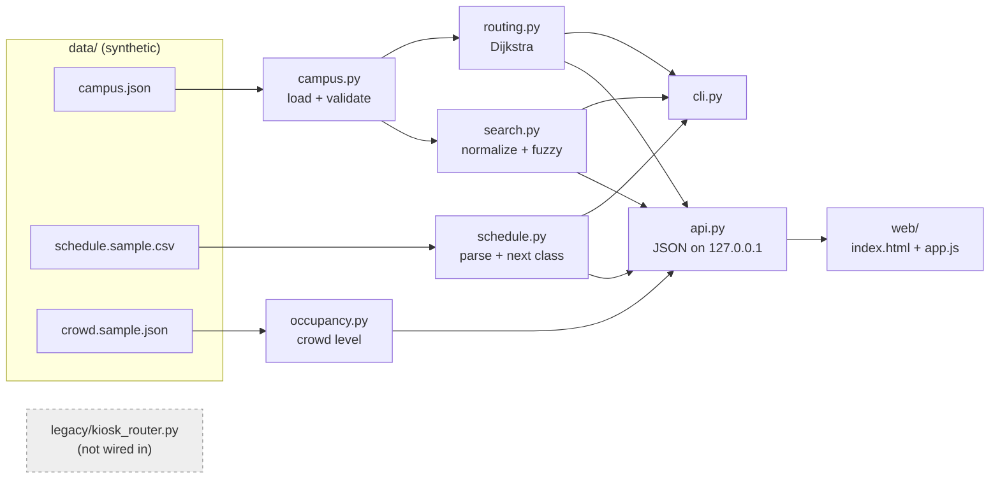
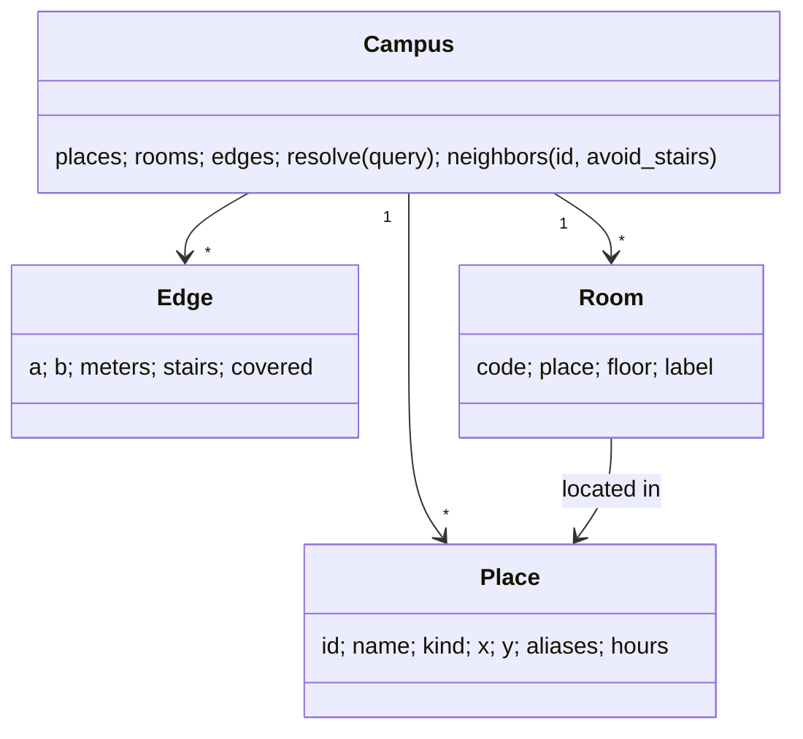

# CampusRoute architecture

## Key decisions

1. **Standard library only.** The app must run on any lab machine with Python 3.9+, no `pip install`.
2. **Pure core, thin edges.** `schedule`, `routing`, `occupancy` never read the clock or the network. The API injects `now` (`clock=` parameter), which keeps tests deterministic.
3. **Graph = undirected walkways.** Each edge has `meters`, `stairs`, `covered`. `avoid_stairs` filters edges, it does not add a penalty.
4. **Resolve strictly, suggest fuzzily.** `Campus.resolve()` only accepts exact id/name/alias/room code (after normalization). Fuzzy matches are shown as suggestions, never silently used, so a typo cannot route you to the wrong building.
5. **Walking time** = `ceil(meters / 80)` minutes. It is an estimate.

## Data model

